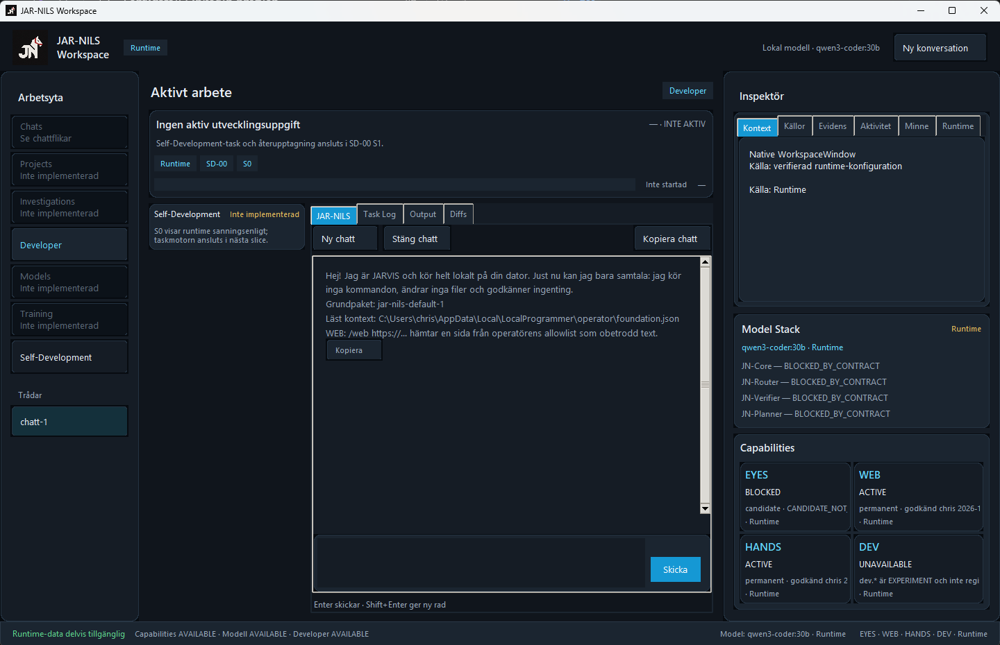
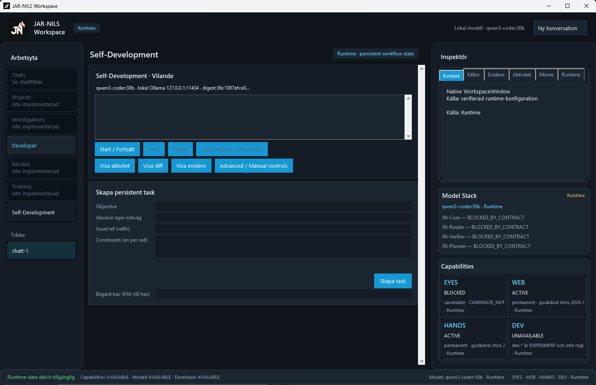

# JAR-NILS
### Local knowledge. Controlled action. Verifiable progress.

**JAR-NILS is a local-first AI programming project founded by Christoffer Runnholm in August 2026.** It explores how a programming assistant can build useful project knowledge, work within explicit boundaries, and check its results against the real project.

[Meet the founder on LinkedIn](https://www.linkedin.com/in/christoffer-runnholm-4269a3448/) · [GitHub profile](https://github.com/scwvwyy9rm-ship-it)

### Support independent development

I'm developing JAR-NILS independently. If you'd like to support the work, voluntary contributions help cover hardware, development tools, testing, and research.

[Ko-fi](https://ko-fi.com/jarnils) · [Buy Me a Coffee](https://www.buymeacoffee.com/jarnils)

## Latest update: LEAN/5S review — ENIGMA, memory and duplicate work

**Architecture review · 3 November 2026 · read-only**

A second LEAN/5S review has identified concrete sources of repeated computation in JAR-NILS. This is a **code-review finding, not an implemented optimization or a performance benchmark**. The findings below refer to the reviewed private implementation revision `main@2ddddbe5c4b7c4851ffc2a2e92d756a88e2e77fb`; later revisions may differ.

- **Verified in reviewed code:** The knowledge index only reuses embeddings when an entire file is unchanged. Editing one line can trigger re-embedding of all its chunks, and identical content at different paths may be computed more than once. File paths and source hashes remain important for provenance.
- **Verified in reviewed code:** ENIGMA's main-branch context compiler applies strict size limits and evidence-ID deduplication; it does **not** silently shorten or compress context. When the current chat budget is exceeded, the request fails closed rather than silently discarding history.
- **Proposed, not shipped:** A content-addressed embedding cache could reuse work for unchanged chunks and identical content across paths **while retaining separate source/provenance records**. Improving chunk boundaries and verified token budgeting are related candidates.
- **Not yet measured:** Time, GPU memory use, power consumption, cache-hit improvements, and savings per completed task. These need controlled tests on the intended Windows/local-model setup.

The guiding constraint remains unchanged: **make computation cheaper without removing scope checks, operator approvals, independent review, or fail-closed safety boundaries.**

The goal is to test whether the system can do more useful work with less repeated computation, not to claim energy or performance savings before evidence exists.

---

## Previous update: a simpler workflow, a clearer learning path

**Development checkpoint · 2 November 2026**

The next goal is to make local AI-assisted development easier to operate: describe an improvement, review a prepared task card, explicitly press **Start**, and follow progress in a compact activity view. Existing approval and verification boundaries remain in place.

### Work in progress

The first UI checkpoint focuses on everyday Windows interaction:
- Mouse-wheel scrolling across content and dynamically created components.
- Small wheel increments and nested scroll areas.
- Selectable, read-only factual text with copying and a context menu.

The latest handoff reports **17 targeted tests passed and 1 skipped because of the Tk test environment**. Import origin was checked against the intended worktree; affected Python files passed compilation and the diff check passed. This is a development checkpoint. Full regression, mutation checks, and independent final review remain outstanding. No release or activation is claimed.

Next comes the task card and activity view on top of the existing orchestration: show the verified repository and revision, current activity, blockers, and the decisions the operator needs to make.

### LEAN, 5S, ENIGMA and learning

A separate architecture study is being prepared to apply LEAN and 5S across workflows, ENIGMA, context, and memory. The question is how to reduce duplicate work and resource use while keeping information useful, traceable, and correct.

The longer-term learning goal is to distil verified experience into compact local lessons with source provenance and separately approved activation. This remains a design goal. The study itself does not activate learning or change the product, and no new performance improvement is claimed.

[Read the development update on LinkedIn](https://www.linkedin.com/feed/update/urn:li:activity:7523118724736835584/)

## Why JAR-NILS?

Writing code is only one part of programming. Understanding the project, knowing what may change, testing a proposed solution, and recovering when something fails matter just as much.

JAR-NILS brings these concerns into the design of the assistant itself. The guiding principle is simple:

> Model output is a proposal. Evidence determines whether it can be accepted.

## Where the project stands

**Active development — November 2026.** This repository is the public project overview. The implementation is maintained separately in private development repositories; this page is not a software release or an installation package.

Development work includes:
- A local project-search workspace for finding source material and assembling relevant context.
- A native Windows conversation interface and integration work with local models.
- Task contracts and capability boundaries that define what an operation may read, change, or execute.
- Bounded change workflows, test execution, provenance checks, and recovery mechanisms.
- Explicit human approval at consequential steps.

These areas have different levels of integration and maturity. Their presence does not mean that every capability is available in one finished product. A complete autonomous programming loop and general self-improvement are longer-term goals.

## Current app — 2 November 2026

### Workspace

The running native app shows its local model, conversation, runtime inspector and capability states. No development task is active at capture time; some navigation areas remain unimplemented.

### Self-Development

The view is idle at capture time and displays persistent task creation, progress, diff, evidence and review controls. This does not imply that no previous development attempts have run.

## Documented local-model development trials

The private implementation repository's Local Developer acceptance record reports three real trials on **Windows 11 with Ollama and qwen3-coder:30b**:

- **Read-only investigation:** exact-commit reads, with the repository reported unchanged.
- **Small code patch:** only the requested parser changed; required checks passed and the result reached `ready_for_review` under required Windows process containment.
- **Failure and correction:** the first iteration failed its test; a corrected second iteration passed.

These are documented historical acceptance results, not a new benchmark run for this page. They demonstrate bounded model-driven development attempts.

Separate orchestration tests exercise S1–S6 workflow services with deterministic model/operator fixtures. Installed end-to-end Self-Development acceptance is a separate check and is not established by those tests or these screenshots.

*Basis: Local Developer acceptance record, orchestration delivery notes and installed S7 acceptance specification, reviewed on 2 November 2026. Raw private records remain private.*

## Examples of the work

| Area | Concrete focus | Why it matters |
| --- | --- | --- |
| Project knowledge | Search approved local projects and retain traceable source context. | Ground answers in project material. |
| Controlled changes | Bind a candidate edit to a defined task, file scope, and required checks. | Keep an operation within its mandate. |
| Verification | Check execution provenance and test results before accepting a change. | Avoid treating a plausible answer as proof. |
| Recovery | Handle failed changes and test the next valid operation after failure. | Make failure recoverable and visible. |
| Desktop experience | Develop a Windows interface for local conversations and clearly surfaced capability state. | Make the system understandable to its operator. |

### An illustrative workflow

1. Define a small task and its permitted scope.
2. Gather relevant project context.
3. Prepare a bounded candidate change.
4. Run the required checks in the intended environment.
5. Review the result and diff.
6. Accept or restore the change according to the applicable workflow.

This illustrates the intended working method, not a claim that every step is currently automated end to end.

## The direction

**Near term:** strengthen the local development foundation, connect capabilities incrementally, and publish reproducible demonstrations of bounded tasks.

**Next:** make verified project knowledge and distilled lessons more useful across tasks, with clear provenance and operator control.

**Longer term:** combine local execution with selective cloud reasoning and evaluate improvements to the system's own components in isolation before any approved promotion.

The protected core, permission boundaries, and acceptance criteria must remain independent of a model's confidence. New capabilities should earn their place through verification.

## About the founder

I'm **Christoffer Runnholm**, founder and developer of JAR-NILS. The project grew out of AI-assisted game development and a practical question: how can an assistant do useful programming work while keeping the human in control?

I lead the project's direction and development, using AI-assisted workflows alongside testing, review, and explicit acceptance criteria.

I'm also motivated by who holds power over AI and what the technology demands from the environment. I want to explore how useful AI can become more accessible and less dependent on a few large providers, while giving people more control over their own computers and data.

For JAR-NILS, that means aiming to use smaller models when they are sufficient, avoid repeated processing, and make better use of hardware people already own. Local AI is not automatically greener: resource use and environmental benefits need to be measured. These are goals I am working towards, not problems JAR-NILS has already solved.

[Read more about these motivations on LinkedIn](https://www.linkedin.com/feed/update/urn:li:activity:7523147284172349440/)

## Connect

I'm interested in exchanging experience with people working on **local AI, programming agents, developer tools, and reliable human–AI workflows**.

- [LinkedIn — Christoffer Runnholm](https://www.linkedin.com/in/christoffer-runnholm-4269a3448/)
- [GitHub — scwvwyy9rm-ship-it](https://github.com/scwvwyy9rm-ship-it)

Follow this repository for public project updates. Questions and constructive feedback are welcome through GitHub Issues.

## Support JAR-NILS

If you'd like to help JAR-NILS move forward, you can support its independent development through either platform:

- [Ko-fi](https://ko-fi.com/jarnils)
- [Buy Me a Coffee](https://www.buymeacoffee.com/jarnils)

Support is entirely voluntary and helps cover development tools, hardware, testing, and research. Contributions are project support, not software license purchases, and do not guarantee product delivery.

---

*JAR-NILS is an independent project in active development. Roadmap items describe direction, not delivery commitments.*
